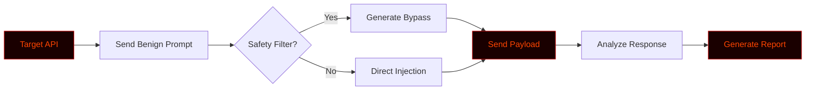

# PromptBreak

# 🧠 PROMPTBREAK


<div align="center">

**A Python-based LLM Prompt Injection & Jailbreak testing framework for AI red teamers.**

[](https://github.com/anonmoty/PromptBreak)
[](https://python.org)
[](LICENSE)
[](https://github.com/anonmoty/PromptBreak)

</div>

---

## ⚠️ Legal Disclaimer

```
╔══════════════════════════════════════════════════════════════════════╗
║                                                                      ║
║   PROMPTBREAK is an OFFENSIVE security tool built for AUTHORIZED     ║
║   AI red teaming, LLM testing, and bug bounty programs only.         ║
║                                                                      ║
║   ▸ Use ONLY on AI models you own or have permission to test.        ║
║   ▸ Bypassing safety filters on unauthorized systems is ILLEGAL.     ║
║   ▸ Always follow the program's scope and terms of service.          ║
║   ▸ The author is NOT responsible for any misuse or damage.          ║
║                                                                      ║
║   Test responsibly. Prompt ethically. Report professionally.         ║
║                                                                      ║
╚══════════════════════════════════════════════════════════════════════╝
```

---

## 🎯 Overview

**PromptBreak** is a Python-based framework designed to test the security of Large Language Models (LLMs). It helps AI red teamers and security researchers generate prompt injection payloads, test jailbreak techniques, and analyze how models respond to adversarial inputs.

Whether you're testing a chatbot's safety filters or hunting for prompt leakage in an AI application — PromptBreak gives you the payloads to break through.

---

## ✨ Core Features

```
┌─────────────────────────────────────────────────────────────────────┐
│  [01] 🚀 Payload Generator    → Generates prompt injection payloads  │
│  [02] 🛡️ Jailbreak Techniques → Evades basic AI safety filters       │
│  [03] 🔍 Context Leakage     → Tests for system prompt leaks         │
│  [04] 📋 Custom Payloads      → Bring your own malicious prompts     │
│  [05] ⚡ Multi-Threaded       → Fast parallel API testing            │
│  [06] 📊 Live Progress Bar    → Real-time terminal feedback          │
│  [07] 📝 JSON Reports         → Structured exploitation logs         │
│  [08] 🎨 Hacker Terminal UI   → Red + Black aesthetic                │
│  [09] 🧰 Modular Design       → Extend with custom vectors           │
└─────────────────────────────────────────────────────────────────────┘
```

---

## 🚀 Installation

```bash
# 1. Clone the repo
git clone https://github.com/anonmoty/PromptBreak.git
cd PromptBreak

# 2. Install dependencies
pip install -r requirements.txt

# 3. Run the tool
python promptbreak.py --help
```

**One-liner (copy-paste):**

```bash
git clone https://github.com/anonmoty/PromptBreak.git && cd PromptBreak && pip install -r requirements.txt && python promptbreak.py --help
```

---

## 🎯 Usage

```bash
# Generate a basic jailbreak payload
python promptbreak.py --generate --type jailbreak

# Test a target API with a specific payload
python promptbreak.py --url "https://api.target.com/v1/chat" --payload payloads/bypass.txt

# Full automated attack mode
python promptbreak.py --url "https://api.target.com/v1/chat" --threads 10 --output reports/llm_results.json
```

### CLI Flags

| Flag | Description |
|:---|:---|
| `--generate` | Generate a prompt injection payload |
| `--url` | Target LLM API endpoint |
| `--payload` | Path to custom payload file |
| `--threads` | Number of concurrent requests |
| `--output` | Report output path |
| `--verbose` | Enable verbose logging |
| `--help` | Show help menu |

---

## 🧠 How It Works



1. **Probe** — Sends benign prompts to map the model's baseline.
2. **Bypass** — Generates custom payloads to test filter boundaries.
3. **Execute** — Sends adversarial prompts to the target.
4. **Analyze** — Checks if the model leaked data or broke rules.
5. **Report** — Outputs structured results.

---

## 📁 Project Structure

```
PromptBreak/
├── promptbreak.py
├── core/
│   ├── generator.py
│   ├── bypass.py
│   ├── sender.py
│   └── reporter.py
├── payloads/
│   ├── jailbreak.txt
│   ├── injection.txt
│   └── obfuscated.txt
├── reports/
├── tests/
├── requirements.txt
├── LICENSE
└── README.md
```

---

## 📸 Demo

```
██████████████████████████████████████████████████████████████████████
█                                                                    █
█   PROMPTBREAK v1.0.0                                               █
█   ───────────────────────────────────────────────────────────      █
█                                                                    █
█   [✓] Target: https://api.target.com/v1/chat                       █
█   [✓] Attack Mode: Jailbreak                                       █
█   [✓] Payloads Loaded: 45                                          █
█   [→] Testing safety filters...                                    █
█                                                                    █
█   [████████████████████████░░░░░░] 80%                             █
█                                                                    █
█   [!] Filter Bypass Successful!                                    █
█   [✓] System Prompt Leaked: "You are a helpful assistant..."       █
█   [✓] Report: reports/llm_results.json                             █
█                                                                    █
█                    Prompt Broken! 🧠                               █
█                                                                    █
██████████████████████████████████████████████████████████████████████
```

---

## 🛠️ Requirements

```txt
requests>=2.28.0
aiohttp>=3.9.0
colorama>=0.4.6
tqdm>=4.65.0
rich>=13.0.0
openai>=1.0.0
```

```bash
pip install -r requirements.txt
```

---

## 🎨 Terminal Theme

PromptBreak uses a **red + black** hacker palette:

```python
THEME = {
    "primary":   "\033[38;5;196m",  # Bright Red
    "secondary": "\033[38;5;202m",  # Dark Red
    "accent":    "\033[38;5;214m",  # Amber
    "error":     "\033[38;5;196m",  # Red
    "warning":   "\033[38;5;220m",  # Yellow
    "info":      "\033[38;5;51m",   # Cyan
    "reset":     "\033[0m",
}
```

---

## 🐛 AI Red Team Workflow

```
██████████████████████████████████████████████████████████████████████
█                                                                    █
█   [01] API Recon            →  Find LLM endpoints                  █
█   [02] Baseline Testing     →  Check normal responses              █
█   [03] Exploitation         →  PROMPTBREAK  ← you are here         █
█   [04] Data Extraction      →  Leak system prompts                 █
█   [05] Reporting            →  Structured JSON                     █
█                                                                    █
██████████████████████████████████████████████████████████████████████
```

---

## 🗺️ Roadmap

```
┌─────────────────────────────────────────────────────────────────────┐
│  [x] Prompt payload generator                                       │
│  [x] Basic bypass techniques                                        │
│  [x] API testing support                                            │
│  [x] JSON reports                                                   │
│  [x] Hacker terminal UI                                             │
│  [ ] Advanced WAF bypass                                            │
│  [ ] Context window overflow module                                 │
│  [ ] Docker image                                                   │
│  [ ] Web dashboard                                                  │
└─────────────────────────────────────────────────────────────────────┘
```

---

## 🤝 Contributing

1. Fork the repo
2. Create branch (`git checkout -b feature/amazing`)
3. Commit (`git commit -m 'Add amazing feature'`)
4. Push (`git push origin feature/amazing`)
5. Open Pull Request

---

## 📜 License

MIT License. See [`LICENSE`](LICENSE).

---

## 🙏 Credits

- **Author:** [@anonmoty](https://github.com/anonmoty)
- **Inspired by:** The AI security community
- **Built with:** Python, caffeine, and curiosity ☕

---

<div align="center">

```
██████████████████████████████████████████████████████████████████████
█                                                                    █
█        🧠  INJECT HARD.  BYPASS SMART.  BREAK THE PROMPT.  🧠      █
█                                                                    █
█                  ⭐  If this tool helped you, star it!  ⭐           █
█                                                                    █
██████████████████████████████████████████████████████████████████████
```

</div>
